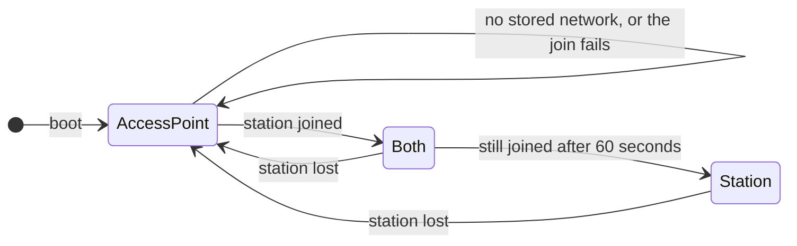

# BamButton-IDF

BamButton-IDF is firmware for an ESP32-C3 Super Mini that clears a Bambu Lab printer plate from a button. It polls Bambuddy, flashes the button LED while the printer is waiting for the plate to be cleared, and sends the clear when the button is pressed.

This is a port of [Bambutton](https://github.com/EdwardChamberlain/Bambutton). The original project is described on the [Bambuddy wiki](https://wiki.bambuddy.cool/community/bambutton/). The button calls the [Bambuddy API](https://wiki.bambuddy.cool/reference/api/#media-token): it reads printer status and posts the plate-clear with the stored API key.

## Using the board

On boot the board opens a setup access point so the configuration page is reachable before it has joined a network:

- SSID: `bambutton-` plus the last six hex digits of the MAC (this board: `bambutton-376764`)
- Password: `bambutton`
- Page: http://192.168.4.1/

Phones do not open that page on their own. Join the access point and open the address.

The access point and the station can run at the same time. This chip has one radio, so once the station joins, the access point moves onto that channel. A phone already on the setup network may need to reconnect once.

If the stored network cannot be joined, the access point stays on. After a successful join it stays on for 60 seconds, which leaves time to finish a change from a phone on the setup network, and then it turns off. The page stays available on the station address and at `bambutton-376764.local`. If the station later drops, the access point comes back, and the 60 seconds start again on the next join.

The same name is the DHCP and mDNS hostname. The station uses DHCP unless the network section sets a static IP, netmask, gateway, and optional DNS. While the access point is up it is at `192.168.4.1`. Factory reset on the page erases the stored settings and restarts into the setup access point.

The LED defaults to GPIO3 and the button to GPIO4, the same ports as Bambutton. Leave the dropdowns alone to keep those. The page only lists the safe header pins: GPIO 0, 1, 3, 4, 5, 6, 7, 10, 20, and 21. GPIO 2, 8, and 9 are strapping pins: GPIO 9 is the BOOT button, GPIO 8 drives the onboard LED and must stay high to enter download mode, and GPIO 2 should stay high at reset. GPIO 11-17 are the in-package flash and GPIO 18-19 are USB, and none of those are on the header. GPIO 20 and 21 are UART0; the console on this board is USB, so they can be used after boot. Saving a pin change stores it and restarts the board.

To update a board that is already running, upload `bambutton-idf.bin` on the configuration page. Stored settings are kept. A blank chip is flashed from the release zip; [docs/README-FLASH.md](docs/README-FLASH.md) is the guide inside that zip. That flash erases the chip, including stored settings.

## Developing

Build and flash from VS Code with the ESP-IDF extension on IDF 5.5.6 and the target `esp32c3`. The serial port is `/dev/ttyACM0`. Do not let another process hold that port while flashing.

The firmware version is whatever `git describe --tags` reports for the checkout. A clean checkout of the tag `0.1.1` is version `0.1.1`. There is no `v` prefix. Pushing that tag publishes the GitHub release `bambutton-idf-0.1.1.zip`. A tag with a suffix, such as `0.1.1-rc.1`, is published as a prerelease. The tag has to be on the commit that is shipped, with a clean tree, because the image version has to match the tag exactly.
